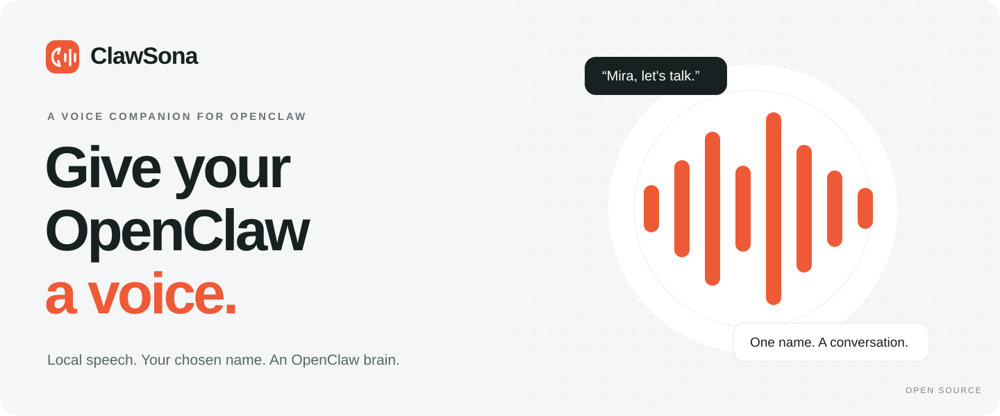
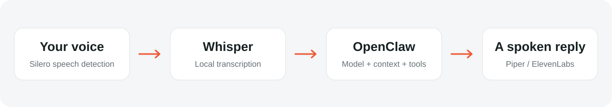

<p align="center">
  
</p>

<p align="center">
  <strong>A voice companion for your mini-PC, built around <a href="https://openclaw.ai">OpenClaw</a>.</strong><br>
  Talk things through. Learn something new. Put your OpenClaw tools to use.
</p>

<p align="center">
  <a href="#quick-start">Get started</a> ·
  <a href="https://github.com/mdfr11/clawsona">GitHub</a> ·
  <a href="#hear-the-voice">Hear the voices</a> ·
  <a href="docs/README.ru.md">Русская документация</a> ·
  <a href="https://mdfr11.github.io/clawsona/">Project page</a> ·
  <a href="CONTRIBUTING.md">Contribute</a>
</p>

<p align="center"><strong>Local speech</strong> &nbsp; / &nbsp; <strong>RU + EN</strong> &nbsp; / &nbsp; <strong>Any name</strong> &nbsp; / &nbsp; <strong>GPL-3.0-or-later</strong></p>

## One name. A conversation.

Call your companion once, then keep talking. Give it a name you like, choose a
voice, and let OpenClaw manage the conversation, context and tools.

| Talk things through | Learn out loud | Ask about the world | Music & more |
| --- | --- | --- | --- |
| “Mira, explain why the sky is blue.” | “Teach me a little Spanish.” | “What's the weather in Paris?” | “Play some jazz.” |
| Ask a follow-up without repeating the name. | Learn with voice-aware model instructions. Local speech supports RU/EN; other pronunciations need a suitable voice. | Let OpenClaw choose the weather or search tool. | Optional Yandex Music is experimental. More actions require the corresponding OpenClaw tools. |

These are example prompts, not prerecorded model results. Recognition and
responses depend on your device, selected model and providers.

## Hear the voice

Real ElevenLabs samples synthesized from public demo text:

| Language | Voice | Sample |
| --- | --- | --- |
| Russian | ElevenLabs / Roger | [▶ «Привет! Я Мира. Давай поговорим.»](website/media/hello-ru.mp3) |
| English | ElevenLabs / Roger | [▶ “Hello! I'm Mira. What would you like to do today?”](website/media/hello-en.mp3) |

The [project page](https://mdfr11.github.io/clawsona/) includes an audio player and interactive
conversation examples. Samples are not a live microphone-to-model demo. See
[media provenance](website/media/README.md) or the [live recording outline](docs/DEMO.md).
The samples use optional paid ElevenLabs TTS. Local bilingual Piper is the
default and does not require a speech subscription.

## A voice layer. An OpenClaw brain.



- **Local ears:** Silero VAD and faster-whisper on CPU.
- **Your identity:** configurable name and aliases, plus natural follow-up turns.
- **One agent:** OpenClaw handles context, model requests and bounded tools.
- **Your voice:** local bilingual Piper, or optional ElevenLabs streaming TTS.
- **Visible performance:** readable timings for recording, recognition, model and playback.

The default setup uses the official DeepSeek API through a separate OpenClaw
profile. Weather uses Open-Meteo without another API key; search uses the DeepSeek
key. No hosted speech service is required. Direct DeepSeek, Ollama and compatible
model endpoints are also available, without agent tools.

See the [architecture](docs/architecture.md) for the implementation boundaries.

## Status and requirements

ClawSona is an early-stage project. The current integration has been tested with
OpenClaw **2026.3.13** on macOS. The CI workflow checks Python on Linux/macOS;
newer OpenClaw releases may require configuration changes. Physical audio and
real provider calls require testing on your device.

You need Python **3.11–3.13**, [uv](https://docs.astral.sh/uv/getting-started/installation/),
a microphone, speakers and [OpenClaw](https://docs.openclaw.ai/install) on `PATH`.
Follow OpenClaw's instructions for the Node.js version required by your release.
Linux and macOS are the target platforms; native Windows has not been validated.

Whisper `small` with four CPU threads is the starting configuration. Speed and
recognition accuracy depend on the device, microphone and background noise.
The companion currently supports Russian and English.

## Quick start

Run these commands from a checkout of this repository:

```bash
git clone https://github.com/mdfr11/clawsona.git
cd clawsona

# Debian/Ubuntu
sudo apt install libportaudio2
# macOS alternative: brew install portaudio

uv python install 3.12
uv sync --python 3.12 --frozen
cp -n .env.example .env
```

Edit `.env` and set your own `DEEPSEEK_API_KEY`. Choose the name and spellings
you want to use, for example:

```dotenv
ASSISTANT_NAME=Мира
ASSISTANT_ALIASES=Mira
```

```bash
uv run clawsona setup             # Download local speech models once
uv run clawsona openclaw-setup    # Configure the dedicated OpenClaw profile
uv run clawsona devices          # List audio devices
uv run clawsona doctor           # Check configuration, models and audio
uv run clawsona                  # Start; Ctrl+C to exit
```

On macOS, allow microphone access for the terminal/application you use to run it.
Choose `INPUT_DEVICE` and `OUTPUT_DEVICE` from `devices` if the defaults are wrong.
`setup` requires internet access; speech models stay in `MODELS_DIR` afterwards.

`openclaw-setup` creates `~/.openclaw-clawsona`, configures the `clawsona` agent,
and generates separate local gateway/tool tokens. It manages that dedicated
profile and its workspace; use it only for ClawSona. Your main OpenClaw profile
is separate. Normal startup starts the local tools and, when needed, the gateway.

Say the configured name alone or include a request in the same sentence.
After a reply, continue speaking without the name for up to
`CONVERSATION_TIMEOUT_S=120` seconds. A goodbye closes the active conversation.
`VAD_SILENCE_DURATION_MS=1800` allows pauses within a sentence; increase it for
longer thinking pauses, at the cost of a slower response after you finish.

## Configuration and optional features

All settings live in `.env`; [.env.example](.env.example) lists the starting values.
Restart after changing them. See the [detailed guide](docs/README.ru.md) for voice
selection, language practice, performance tuning, timings and Linux autostart.

| Setting | Purpose |
| --- | --- |
| `ASSISTANT_NAME`, `ASSISTANT_ALIASES` | Name and optional comma-separated spellings |
| `STT_LANGUAGE=auto` | Detect Russian/English per utterance; `ru` or `en` forces one |
| `WHISPER_MODEL=small` | Local recognition model; run `setup --only stt` after changing it |
| `TTS_PROVIDER=piper` | Local bilingual TTS; `elevenlabs` enables paid cloud speech |
| `PIPER_VOICE`, `PIPER_ENGLISH_VOICE` | Local RU/EN voices; run `setup --only tts` after changing them |
| `FOLLOW_UP_WITHOUT_NAME=true` | Continue the conversation without repeating the name |
| `LOG_TRANSCRIPTS=false` | Keep timings without logging recognized phrases |
| `MUSIC_PAUSE_DURING_SPEECH=true` | Pause music for the entire spoken reply, then resume unless the user paused or stopped it |

ElevenLabs requires your API key and voice ID. Use `clawsona elevenlabs-voices`
to list voices, and `clawsona voice-test` to hear your selection. Local Piper
fallback is optional. API usage is billed by the provider.

Yandex Music is experimental and disabled by default. It uses an unofficial
client, an additional `music` extra, FFmpeg and a personal account/subscription.
It has not been validated end to end. See the [music guide](docs/README.ru.md#яндекс-музыка-экспериментальная).
Legacy Deepgram/edge-tts support is available in the `cloud-speech` extra.

## Data and current limitations

- The microphone and default speech processing are local. Recognized requests
  are sent to the configured model; with ElevenLabs, reply text is sent there too.
- The microphone is closed during playback. Interruption and acoustic echo
  cancellation are not implemented. Name activation uses Whisper transcription,
  so nearby speech and recognition errors can still cause false activations.
- With `FOLLOW_UP_WITHOUT_NAME=true`, nearby speech may be treated as a follow-up
  while the conversation window is open. This is not speaker verification.
- Rotating logs are local. With `LOG_TRANSCRIPTS=true`, they include recognized
  text and model input. Audio is not saved during normal conversation.
- OpenClaw stores session history in its own profile. Disabling transcript logs
  does not remove that history. Clear or manage it separately in OpenClaw.
- The generated profile exposes weather/search and optional music tools. Shell,
  arbitrary file access, outgoing messages and scheduled tasks are not enabled.
- Model weights are downloaded separately and have their own terms. Read
  [third-party notices](docs/THIRD_PARTY_NOTICES.md) before redistributing them.

## Development

```bash
uv sync --frozen --all-extras
uv run ruff check src tests scripts
uv run ruff format --check src tests scripts
uv run pytest -q
node --check openclaw/clawsona-tools/index.js
uv build
uv run python scripts/check_distribution.py dist
```

Unit tests use mocks and local HTTP servers. They need no API keys, models,
OpenClaw installation or physical audio devices. `doctor --check-llm` and
`doctor --check-speech` are separate, opt-in integration checks. See
[CONTRIBUTING](CONTRIBUTING.md) and [security reporting](SECURITY.md).

## Upgrading from Lyutik

Keep your `.env` and downloaded models. If the old settings did not explicitly
set a profile/agent, add `OPENCLAW_PROFILE=lyutik` and `OPENCLAW_AGENT=lyutik` to
keep the existing OpenClaw sessions. Stop the application and any separately
started ClawSona gateway before reconfiguration:

```bash
uv sync --frozen
uv run clawsona openclaw-setup
uv run clawsona
```

The old `lyutik` CLI, `python -m lyutik`, `WAKE_WORD`, and `LYUTIK_TOOLS_*`
variables remain compatible. Existing model/auth caches are reused when the new
locations do not exist. The workspace directory itself does not need renaming.

## License

ClawSona is licensed under [GPL-3.0-or-later](LICENSE). Dependencies, model weights
and third-party services retain their own licenses and terms; see
[THIRD_PARTY_NOTICES](docs/THIRD_PARTY_NOTICES.md).

ClawSona is an independent project built around OpenClaw, not an official
OpenClaw product or an endorsement by any model, voice or music provider.
