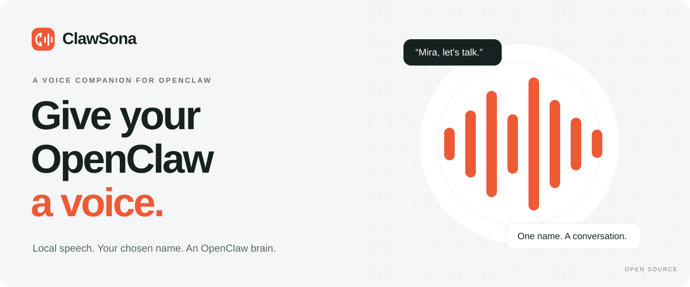

# ClawSona



Voice companion for OpenClaw. Голосовой компаньон для общения и обучения на мини-ПК.

Послушать реальный голос ElevenLabs (Roger):
[Русский](../website/media/hello-ru.mp3) ·
[Английский](../website/media/hello-en.mp3).
Страница проекта: [запуск и публикация](../website/README.md).

Проект ранее назывался Lyutik. Для существующей установки сохраните `.env`,
остановите приложение, выполните `uv sync --frozen` и `uv run clawsona openclaw-setup`,
затем запускайте `uv run clawsona`. Существующие `OPENCLAW_PROFILE`, `OPENCLAW_AGENT`
и `MODELS_DIR` продолжают использоваться. Старые `LYUTIK_TOOLS_TOKEN` /
`LYUTIK_TOOLS_PORT`, команда `lyutik` и запуск `python -m lyutik` поддерживаются
для перехода. Новый префикс настроек инструментов — `CLAWSONA_TOOLS_*`.
Без явного `MODELS_DIR` ранее скачанные модели в `~/.local/share/lyutik/models`
используются автоматически, пока каталога `~/.local/share/clawsona/models` нет.
Если в прежнем `.env` профиль и агент не были указаны, перед `openclaw-setup`
добавьте `OPENCLAW_PROFILE=lyutik` и `OPENCLAW_AGENT=lyutik`, чтобы сохранить
историю диалогов. Новые установки используют профиль и агента `clawsona`.

Голосовой собеседник для мини-ПК: локальный Whisper, озвучка Piper или ElevenLabs,
агент OpenClaw, модель DeepSeek Flash через официальный API. OpenClaw выбирает инструменты
погоды и поиска. Яндекс Музыка доступна как экспериментальная опция и по умолчанию отключена.

OpenClaw — единственный агентный слой проекта: он ведёт сессию, вызывает
модель и выбирает инструменты. Python-приложение отвечает за распознавание речи, озвучку,
обращение по имени и воспроизведение ответа.

English overview: [README](../README.md).

## Имя собеседника и обращение

Имя задаётся в `.env` и не зависит от названия проекта. Например:

```dotenv
ASSISTANT_NAME=Мира
ASSISTANT_ALIASES=Mira
```

Можно выбрать своё имя, в том числе из нескольких слов. `ASSISTANT_ALIASES` —
необязательные варианты через запятую: например, латинское написание для общения
на английском. Без вариантов оставьте значение пустым. После смены имени проверьте
список вариантов и перезапустите приложение. Имя используется в обращении,
подсказке распознавания, инструкциях модели и сообщениях приложения.
Прежний `WAKE_WORD` поддерживается для старых конфигураций; при наличии
`ASSISTANT_NAME` используется новое поле. `openclaw-setup` сохраняет выбранное имя
и режим активации. В примерах ниже используется Мира — замените её своим именем.

Можно сказать «Мира» и дождаться короткого естественного отклика, который
выберет модель. Можно сразу сказать всю просьбу: «Мира, привет, объясни, как
работают дроби» — фраза записывается целиком, без обязательного «Слушаю» посередине.

Микрофон → Silero VAD → локальный Whisper → проверка уверенности и обращения → OpenClaw → Piper / ElevenLabs.

- Имя распознаётся тем же локальным Whisper. Отдельной английской модели
  активации больше нет. В режиме ожидания имени речь без обращения не
  отправляется в облако.
- Активация распознаётся в начале фразы, в том числе после «привет» или «эй».
  Упоминание Миры в середине чужого разговора не считается обращением.
- Достаточно обратиться по имени один раз: после отклика или ответа можно
  продолжать диалог без повторного «Мира». После каждого ответа есть
  `CONVERSATION_TIMEOUT_S=120` секунд на следующую реплику. Шум и отклонённое
  распознавание не продлевают это окно. После паузы снова требуется имя,
  но контекст сохраняется.
- `FOLLOW_UP_WITHOUT_NAME=false` включает строгий режим: после обычного ответа
  снова требуется имя. Отдельное «Мира» всё равно открывает окно для вопроса.
- «Мира, новый разговор» / «Мира, забудь разговор» очищают локальный контекст и создают новую
  сессию OpenClaw. «Пока» / «до свидания» завершают активный разговор.
- В режиме OpenClaw «стоп» передаётся агенту: например, чтобы остановить музыку.
- `ACTIVATION=continuous` отключает требование имени.

Это распознавание полной реплики после паузы, а не специально обученный
акустический детектор ключевого слова. Whisper запускается на речевых
фрагментах, включая фоновую речь; это следует учитывать при выборе CPU.
Silero работает локально через ONNX Runtime; модель уже входит в faster-whisper,
отдельный сервис, PyTorch или загрузка модели VAD не нужны. Перед декодированием
речь проверяется повторно; неуверенные сегменты Whisper отбрасываются.
`VAD_SILENCE_DURATION_MS=1800` задаёт паузу окончания реплики: до 1,8 секунды
без распознанной речи, чтобы можно было подумать между словами. Возобновление речи
сбрасывает этот таймер. Для более длинных пауз при практике языка можно поставить
`2500`; это также увеличит ожидание после действительного конца фразы.
После изменения `.env` перезапустите приложение. Во время ответа
микрофон отключён: перебивание озвучки и акустическое эхоподавление пока
не реализованы. Если играет музыка, качество захвата голоса зависит от
микрофона, расстояния и громкости динамика.

## Запуск

Нужны Python 3.11–3.13, uv, микрофон и динамик. OpenClaw должен быть установлен
по [официальной инструкции](https://docs.openclaw.ai/install). Интеграция
проверена с OpenClaw 2026.3.13; для новой установки используйте актуальную
поддерживаемую версию и соответствующую ей версию Node.js.

```bash
# Debian/Ubuntu: PortAudio; FFmpeg нужен только для воспроизведения музыки.
sudo apt install libportaudio2 ffmpeg
# macOS: brew install portaudio ffmpeg

git clone https://github.com/mdfr11/clawsona.git
cd clawsona

uv python install 3.12
uv sync --python 3.12 --frozen
# Только для новой установки; существующий .env с ключом сохраните.
cp -n .env.example .env
```

Заполните `DEEPSEEK_API_KEY` в `.env`.

```bash
uv run clawsona setup
uv run clawsona openclaw-setup
uv run clawsona devices
uv run clawsona
```

`openclaw-setup` создаёт отдельный профиль `~/.openclaw-clawsona`, агента `clawsona`
и его рабочую папку. Основной профиль OpenClaw не меняется. Ключ DeepSeek
остаётся в `.env`; процесс шлюза получает его через окружение.
`OPENCLAW_PROFILE` и `OPENCLAW_AGENT` — технические идентификаторы, отдельные
от имени собеседника. При смене `ASSISTANT_NAME` их менять не требуется.
Системные инструкции в профиле нейтральны: актуальное имя передаётся модели
из настроек при каждом запросе.

Обычный `clawsona` запускает локальные инструменты и при необходимости свой
Gateway. Если Gateway уже работает, приложение использует его и при выходе
не останавливает чужой процесс. Для диагностики можно запустить компоненты
отдельно:

```bash
uv run clawsona openclaw-gateway  # шлюз, первый терминал
uv run clawsona tools             # инструменты, второй терминал
uv run clawsona doctor --check-llm --check-speech
```

Шлюз использует loopback-порт 18791, локальные инструменты — 18792. Оба требуют
свои токены, которые генерируются при подготовке и не передаются в промпт.
Агенту разрешены погодный и поисковый инструменты и сведения о сессии.
Музыкальный инструмент появляется только при явном `MUSIC_ENABLED=true`. Shell, чтение/изменение произвольных файлов, исходящие сообщения и
планировщик ему не предоставлены.

## Возможности OpenClaw

- `clawsona_weather`: текущая погода и прогноз до семи дней вперёд через
  [Open-Meteo](https://open-meteo.com/en/docs). Дополнительный ключ не требуется.
  При неоднозначном городе инструмент просит уточнить место.
- `clawsona_search`: поиск через официальный DeepSeek Search с тем же ключом.
  Поиск может тарифицироваться отдельно от генерации текста; актуальные условия
  указаны в [документации DeepSeek](https://api-docs.deepseek.com/).
- `clawsona_music`: Яндекс Музыка — поиск и воспроизведение трека, пауза,
  продолжение, остановка и состояние плеера. Если название не задано, запускается
  первый трек из «Мне нравится». Автоматическая очередь следующих треков пока
  не реализована.

В голос передаётся окончательный ответ OpenClaw после выполнения инструментов.
Промежуточные сообщения агента и аргументы инструментов не озвучиваются.
Сессия агента сохраняет контекст и результаты инструментов; повторная отправка
полной локальной истории не выполняется, чтобы не дублировать действия.

## Яндекс Музыка (экспериментальная)

По умолчанию `MUSIC_ENABLED=false`, агент не получает
музыкальный инструмент и не обращается к Яндексу. Для подключения:

```bash
uv run --extra music clawsona yandex-login
```

Подтвердите вход по адресу и коду из терминала. Затем укажите
`MUSIC_ENABLED=true` в `.env` и выполните:

```bash
uv run --extra music clawsona openclaw-setup
uv run --extra music clawsona
```

Сохраняйте `--extra music` при каждом запуске через uv, чтобы музыкальная
зависимость оставалась установленной. После изменения настроек перезапустите
приложение и отдельно запущенный шлюз OpenClaw.

`MUSIC_PAUSE_DURING_SPEECH=true` автоматически ставит музыку на паузу перед
озвучкой и продолжает её после полного ответа, включая ответы из нескольких
фраз. После ошибки или отмены озвучки автопауза снимается. Явная пользовательская
пауза или остановка сохраняется: бот сам не возобновит такой трек.
Чтобы отключить это поведение, задайте `MUSIC_PAUSE_DURING_SPEECH=false`.


Используется [неофициальный клиент yandex-music](https://github.com/MarshalX/yandex-music-api),
поскольку это не публичный официальный API Яндекс Музыки. Подключение проходит
через Device Flow: `yandex-login` показывает адрес Яндекса и одноразовый код,
вы подтверждаете вход в браузере. Пароль приложению не передаётся.

Токены сохраняются в `~/.local/share/clawsona/yandex-auth.json` с правами `0600`.
Для полного воспроизведения нужна активная подписка Яндекс Плюс. При истечении
или отзыве токена повторите `clawsona yandex-login`. Плеер использует `ffplay`,
поэтому на мини-ПК нужен пакет FFmpeg. Воспроизведение идёт на том компьютере,
где запущено приложение. Редирект звука на другое устройство Яндекса не реализован.

Примеры: «Мира, включи Кино, Группа крови», «Мира, поставь на паузу»,
«Мира, продолжи музыку», «Мира, останови музыку».

## Настройка мини-ПК

- `WHISPER_MODEL=small`, четыре потока CPU и `WHISPER_BEAM_SIZE=5` — стартовый
  профиль распознавания. На слабом устройстве можно выбрать `base` или `tiny`
  и уменьшить `WHISPER_BEAM_SIZE`, с возможной потерей точности коротких фраз
  и имени. После смены модели: `clawsona setup --only stt`.
- `STT_HOTWORDS` по умолчанию пуст: географические и другие персональные
  подсказки не заданы. Имя обращения берётся из `ASSISTANT_NAME`.
- `STT_LANGUAGE=auto` выбирает русский или английский для каждой реплики
  Whisper. Он расшифровывает речь, не переводя её на русский. Для разговора
  строго на одном языке можно задать `ru` или `en`.
- `VAD_THRESHOLD=0.6` задаёт порог вероятности речи Silero. Повышение порога
  уменьшает чувствительность, но может пропускать тихий голос.
- `VAD_PRE_ROLL_MS=1000` сохраняет секунду аудио перед подтверждённым началом
  речи, чтобы задержка VAD не обрезала первые слоги обращения.
- `STT_MIN_LOGPROB=-1.0`, `STT_MAX_NO_SPEECH_PROB=0.5` и
  `STT_MAX_COMPRESSION_RATIO=2.4` отсекают неуверенное распознавание. Причина
  отбрасывания видна при `LOG_LEVEL=DEBUG`. Реальная речь из телевизора или
  разговора рядом всё ещё может пройти акустическую проверку; требование имени
  остаётся отдельной защитой.
- `INPUT_DEVICE` / `OUTPUT_DEVICE`: имя или индекс из `clawsona devices`.
  Для USB устройств предпочтительно имя, поскольку индекс может меняться.
- Запись: mono PCM int16, 16 кГц. Другой `SAMPLE_RATE` отклоняется.
- Модели находятся в `MODELS_DIR`. Для переноса скопируйте их на мини-ПК,
  заново установите зависимости под его ОС и повторите `openclaw-setup`.
  Виртуальное окружение с Mac на Linux не переносится.

Микрофон и распознавание работают локально. По умолчанию озвучка тоже локальная
(Piper); при выборе ElevenLabs текст ответа отправляется этому сервису для синтеза.
Во время обычного общения используется DeepSeek;
погода добавляет запросы к Open-Meteo, музыка — к Яндексу. Историю сессий
OpenClaw хранит в своём профиле. Семантический поиск памяти и фоновый heartbeat
в профиле собеседника отключены.

## Смена голоса

Озвучку можно сменить, сохранив локальную работу. В
[каталоге русских голосов Piper](https://huggingface.co/rhasspy/piper-voices/tree/main/ru/ru_RU)
есть `ru_RU-denis-medium`, `ru_RU-dmitri-medium`, `ru_RU-irina-medium` и
`ru_RU-ruslan-medium`. Сначала скачайте выбранную модель и послушайте пример:

```bash
uv run clawsona setup --only tts --voice ru_RU-dmitri-medium
uv run clawsona voice-test --voice ru_RU-dmitri-medium
# Сохранение примера без включения динамика, микрофона или модели диалога:
uv run clawsona voice-test --voice ru_RU-dmitri-medium --output /tmp/clawsona-dmitri.wav
```

`--say "Ваш текст"` задаёт фразу для проверки. `--voice` выбирает голос на один
запуск и не меняет `.env`. Для постоянного выбора запишите в `.env`
`PIPER_VOICE=ru_RU-dmitri-medium`, затем перезапустите приложение.
Загрузка модели нужна один раз; при обычной озвучке сеть не используется.

### ElevenLabs: один голос для русского и английского

Для облачной озвучки используется
[Eleven v4 Turbo через Text to Dialogue WebSocket](https://elevenlabs.io/docs/eleven-api/guides/how-to/websockets/realtime-tdd).
Звук поступает сразу в PCM 24 кГц: дополнительный SDK и FFmpeg не нужны.
Подключение к ElevenLabs начинается параллельно с запросом к модели и закрывается
после ответа, ошибки или отмены. Пока модель думает, служебные сообщения поддерживают
соединение; текст для синтеза отправляется только после получения ответа.
Готовый ответ OpenClaw передаётся в один поток озвучки целиком, чтобы не создавать
новое подключение и паузу перед каждым предложением. Русский и английский остаются
в одном контексте голоса. При прямом потоковом подключении к модели сохраняется
озвучка по предложениям по мере поступления текста.
Это платный API, кредиты расходуются на текст ответа. В ключе достаточно
`Text to Speech → Access` и `Voices → Read`; остальные права не требуются.
Сохраните ключ в локальном `.env`, затем получите доступные ID:

```bash
uv run clawsona elevenlabs-voices
```

Укажите в `.env`:

```dotenv
TTS_PROVIDER=elevenlabs
ELEVENLABS_API_KEY=ваш_ключ
ELEVENLABS_VOICE_ID=ID_из_списка
ELEVENLABS_MODEL=eleven_v4_turbo
ELEVENLABS_TIMEOUT_S=45
ELEVENLABS_FALLBACK=true
```

Проверьте выбранный голос без запуска микрофона и модели диалога:

```bash
uv run clawsona voice-test --say "Привет! Hello, how are you?"
uv run clawsona voice-test --say "Привет! Hello, how are you?" --output /tmp/clawsona-elevenlabs.wav
```

Без `--voice` проверяется выбранный `TTS_PROVIDER`; с `--voice` — конкретный
локальный Piper. В обычном диалоге при сбое ElevenLabs до начала воспроизведения
включается Piper (`PIPER_VOICE` / `PIPER_ENGLISH_VOICE`). `clawsona setup --only tts`
подготовит резервные голоса, если `ELEVENLABS_FALLBACK=true`. После начала звука
ошибка прерывает озвучку: весь ответ повторно не произносится.
Экспорт `--output` проверяет именно ElevenLabs и при ошибке не подменяет его Piper.
`ELEVENLABS_TIMEOUT_S` ограничивает ожидание подключения и очередного сетевого
сообщения. Для возврата к полностью локальной озвучке: `TTS_PROVIDER=piper`.
Изменения `.env` вступают в силу после перезапуска приложения.

## Разговор и обучение на английском

Скажите «Мира, давай поговорим на английском». Модель получает инструкцию вести
дальнейший разговор на английском до просьбы сменить язык. Ей также передаётся
контекст голосового ввода: это автоматическая расшифровка, которая может ошибаться
в словах и алфавите. По тексту она не должна оценивать произношение или упрекать
человека за якобы использованные русские слова. При понятном смысле она продолжает
разговор; при сомнении мягко уточняет формулировку.
Латинское написание имени задаётся через `ASSISTANT_ALIASES`, например `Mira`.
Учитываются только заданные варианты в начале реплики; нечёткое совпадение
и случайные упоминания имени в середине фразы не используются.

Для английских фрагментов Piper автоматически использует
`PIPER_ENGLISH_VOICE=en_US-ljspeech-medium`, для русских — `PIPER_VOICE`.
В смешанной фразе переключение происходит между группами слов по алфавиту.
При такой смене меняется и тембр: это два локальных голоса. `clawsona setup --only tts`
подготавливает обе модели, английская загружается в память при первом использовании.
После обновления инструкций выполните `clawsona openclaw-setup` и перезапустите приложение.

```bash
uv run clawsona voice-test --say "Hello! How was your day?"
uv run clawsona voice-test --say "Скажи Hello, how are you? и продолжи по-русски." --output /tmp/clawsona-bilingual.wav
```

При `TTS_PROVIDER=piper` без `--voice` команда проверяет автоматический выбор языка. С явным `--voice`
она использует только указанную модель. В обычном текстовом режиме контекст
микрофона модели не передаётся. Определение языка не делает короткие и смешанные
реплики безошибочными; выбранный Whisper язык виден в замерах `stt`.

## Замеры времени

В новой установке текст реплик не записывается: `LOG_TRANSCRIPTS=false`.
Для отладки можно явно включить `LOG_TRANSCRIPTS=true`; замеры времени
доступны в обоих режимах. История OpenClaw хранится отдельно.

При `LOG_LEVEL=INFO` строки `TIMING` появляются в консоли и в
`LOG_FILE=logs/clawsona.log`. Файл ротируется: до 5 МБ и три резервные копии.
Пустой `LOG_FILE=` отключает запись в файл. Каталог логов исключён из Git.

```bash
tail -f logs/clawsona.log
```

После `TIMING` записан JSON: `turn` — номер попытки реплики, `stage` — этап,
`duration` — длительность по монотонным часам, `status` — `ok`, `error` или
`cancelled`. Текст реплик и ключи в эти строки не включаются. Один `turn`
сохраняется в задачах модели, озвучки и рабочих потоках STT/TTS.
Длительности выводятся с единицами: `125 мс`, `9,88 с`, `1 мин 5,4 с`.
Для очень коротких этапов используются микросекунды. Дополнительные временные
поля тоже форматируются с единицами, без суффикса `_ms` в названии.

При `LOG_TRANSCRIPTS=true` отдельно записываются строки `TRANSCRIPT` с текстом
Whisper и решением `addressed`, `follow_up`, `ignored` или `rejected` и
`MODEL_INPUT` с фактическим текстом пользовательского сообщения для модели.
У них тот же `turn`, что и у замеров. У отклонённого распознавания видны
неуверенный кандидат (если декодер успел его получить) и причина отбрасывания.
При пропуске фразы без имени событие `MODEL_INPUT` не появляется. Текстовые
события попадают в консоль и локальный файл; `LOG_TRANSCRIPTS=false` отключает
их, сохраняя замеры. Аудиозаписи не сохраняются.

| Этап | Что измеряется |
| --- | --- |
| `startup_*` | Подготовка локальных инструментов, Gateway, STT, TTS и VAD |
| `audio_open`, `audio_close` | Открытие и закрытие микрофона |
| `capture_wait` | Ожидание подтверждённого начала речи, включая открытие микрофона |
| `capture_record`, `capture_total` | Запись после начала речи и вся попытка захвата |
| `vad_stream` | Суммарное время вычислений потокового VAD, без ожидания микрофона |
| `stt_vad`, `stt_language`, `stt_decode`, `stt_total` | Проверка речи, определение языка, декодирование Whisper и весь вызов STT |
| `activation` | Проверка обращения по имени |
| `llm_first_text`, `llm` | Первый непустой текст и весь поток модели |
| `reply_first_sentence` | Готовность первого фрагмента для озвучки |
| `tts_first_pcm`, `tts_total` | Первые PCM-данные и полный вызов озвучки одной фразы |
| `piper` | Полная озвучка Piper; отдельно `synthesis`, `output_write`, `output_drain`, `device_open`, `audio` |
| `elevenlabs_connect`, `elevenlabs_first_chunk` | Подключение WebSocket и ожидание первого PCM-фрагмента от ElevenLabs |
| `elevenlabs_ready` | Оставшееся ожидание подключения после готовности текста; `preconnected=true` означает использование соединения, подготовленного параллельно с моделью |
| `elevenlabs` | Сетевая озвучка вместе с воспроизведением; отдельно `output_write`, `output_drain`, `device_open`, `audio` |
| `capture_to_first_audio` | От завершения захвата до передачи первых PCM-данных звуковому устройству |
| `reply_total`, `turn_total` | Ответ целиком и вся попытка реплики; `turn_total.after_capture` исключает захват |
| `tool`, `weather_geocode`, `weather_forecast`, `search_request` | Вызов инструмента и его сетевые этапы |

`capture_record.audio` — длина записанного буфера, а
`end_silence_config` — настроенная пауза завершения речи; эта пауза уже входит
в захват, но не в `capture_to_first_audio`. Последняя метрика также не включает
аппаратную задержку динамика. `capture_record.end_reason=silence` означает
завершение по паузе, `max_length` — по ограничению `MAX_UTTERANCE_S`,
`interrupted` — прерывание захвата. `end_silence` показывает фактическую длительность
паузы по VAD, округлённую до кадра 32 мс. Это помогает отличить преждевременное
завершение записи от ошибки распознавания уже записанной фразы.
`piper.audio` — длина записанных в устройство
аудиоданных, а `output_write` — время блокирующих записей в его буфер.
`output_drain` — ожидание воспроизведения остатка при закрытии устройства.
У ElevenLabs `elevenlabs_connect` может полностью или частично пересекаться с
`llm`; это время нельзя повторно прибавлять к `tts_total`. Отсчёт
`elevenlabs_first_chunk` начинается при передаче готового текста в озвучку.

STT включает вложенные VAD и декодирование. Модель и озвучка могут работать
одновременно, поэтому длительности этапов нельзя просто складывать. У `llm`
поле `provider_wait` учитывает только ожидание данных провайдера, исключая
ожидание освобождения очереди озвучки. В OpenClaw первый текст — окончательный
ответ агента после инструментов, а не первый токен DeepSeek. Вызовы инструментов
проходят через отдельные HTTP-запросы Gateway: у них `turn="-"` и свой
`tool_call`, сопоставляйте их с ответом по временным меткам. Параметры запросов
в замеры не записываются.

## Другие режимы

Без агента и инструментов: `LLM_PROVIDER=deepseek`, `LLM_MODEL=deepseek-flash`.
Полностью локальная LLM: `LLM_PROVIDER=ollama`, `LLM_MODEL=qwen2.5:3b`, после
установки Ollama и загрузки модели. `LLM_PROVIDER=custom` поддерживает другой
совместимый endpoint через `LLM_BASE_URL`, `LLM_MODEL` и `LLM_API_KEY`.

`uv run clawsona --text` позволяет проверить диалог и инструменты без микрофона.
`/reset` — новый разговор, `/quit` — выход. Прямой OAuth-вход ChatGPT в голосовом
приложении не реализован; провайдера OpenClaw можно настраивать отдельно.
Прямые режимы подключают только модель и не предоставляют агентные инструменты.
Для обычного запуска используется `LLM_PROVIDER=openclaw`.

## Linux и проверки

Пример автозапуска: [deploy/clawsona.service](../deploy/clawsona.service). Он рассчитан
на checkout в `~/clawsona` и uv в `~/.local/bin/uv`. Сначала проверьте запуск
вручную и поправьте пути, если они отличаются.

```bash
mkdir -p ~/.config/systemd/user
cp deploy/clawsona.service ~/.config/systemd/user/
systemctl --user daemon-reload
systemctl --user enable --now clawsona
journalctl --user -u clawsona -f
```

Пользовательский сервис предполагает работающий пользовательский аудиосервер.
Для запуска без входа в систему отдельно настраиваются звук и linger.

```bash
uv sync --frozen
uv run pytest -q
uv run ruff check src tests scripts
uv run clawsona doctor
uv run clawsona doctor --check-speech
```

`doctor --check-llm` делает настоящий запрос к выбранному backend. Проверка
`--check-speech` синтезирует и распознаёт русскую фразу без включения динамика
и записи микрофона. `--no-audio` пропускает проверку аудиоустройств.
Тесты проверяют оба сценария обращения, фильтрацию фоновой речи, границы
записи, историю, реальный локальный HTTP и авторизацию инструментов.
Необязательные старые Deepgram/edge-tts доступны через extra `cloud-speech`.

## Разработка и лицензия

Правила участия: [CONTRIBUTING](../CONTRIBUTING.md). Архитектура:
[architecture](architecture.md). Исходный код — [GPL-3.0-or-later](../LICENSE).
У библиотек и скачиваемых голосовых моделей свои лицензии; см.
[THIRD_PARTY_NOTICES](THIRD_PARTY_NOTICES.md).
